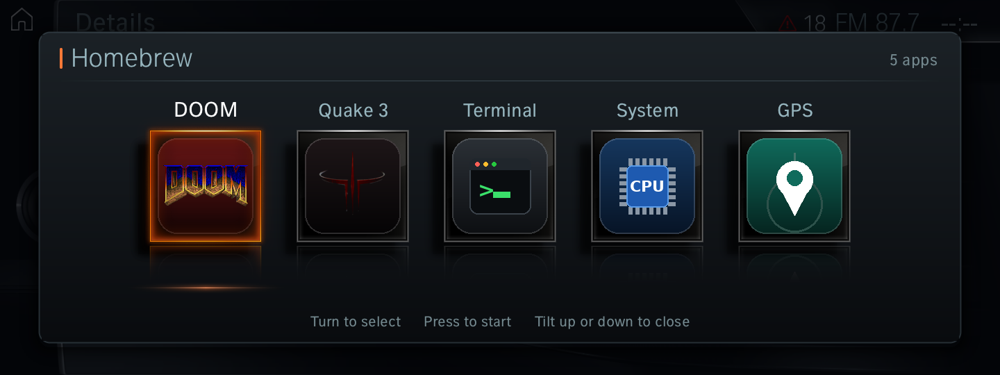

# NBT EVO Homebrew

Native apps for a **BMW NBT EVO (ID5)** head unit — the car's own infotainment
computer (QNX 6.5 on a TI OMAP5 / Cortex-A15, 1440×540 centre display). This
repo turns that closed box into something you can write and run your own
full-screen apps on: a resident **launcher** draws a tile page over the live
OEM HMI, you summon it with the iDrive knob, pick a tile, and your app owns the
screen until you press **BACK** — no OEM firmware changes, no flashing.

Yes, it runs **DOOM**. It also runs Quake 3, a shell, a system monitor and a
live GPS readout — and adding your own app is a 3-line Makefile and a one-line
descriptor.



<sub>Summon with an iDrive ▲/▼ tilt on the Startmenu; the page floats over the dimmed OEM HMI (per-pixel alpha). Rotate to move, press to launch, tilt up/down to close — the row scrolls once you pass six apps.</sub>

> **Research project.** Built and tested on a **bench** head unit (never in a
> car). Not affiliated with or endorsed by BMW. Everything here runs in user
> space over the running system; it does not reflash or modify OEM images.

## What it does

- **Run native apps on the car screen** — full-screen QNX programs that draw
  through the shared graphics library and exit cleanly on the iDrive BACK button.
- **A launcher you summon with the knob** — resident daemon; an up/down tilt on
  the main Startmenu opens a tile page composited *over* the live HMI with alpha
  (not a mode switch). Rotate to move, press to launch, up/down to dismiss. The
  row scrolls with arrows/dots once you have more than one page of apps. The look
  adapts to the unit: it reads the HMI generation/brand from the unit's coding
  and uses the unit's own fonts and tile artwork, with a procedural fallback.
- **Summon only from the home screen** — a lightweight detector gates the summon
  to the Startmenu, so the page never pops over a submenu or a running app (and
  fails open if the detector isn't running).
- **Drop-in apps** — each app is a folder with a source file, a 3-line Makefile
  and an `app.desc`; one command builds everything and pushes it to the unit, and
  the launcher hot-reloads the tile list on the next summon.
- **Talk to the car's own services** — a bundled DSI client
  ([`projects/nbt-dsi-toolkit`](projects/nbt-dsi-toolkit)) resolves and calls the
  unit's internal services, so apps can read live GPS position, navigation state
  and more.

## The apps

| Tile | What it is |
|------|------------|
| **DOOM** | The shareware game, running on the head unit with sound out the car speakers; iDrive BACK quits, the knob/5-way drives it. (Bring your own `doom1.wad`.) |
| **Quake 3** | ioquake3 / quake3e port on the PowerVR GPU via GLES2. (Bring your own `pak0.pk3`.) |
| **Terminal** | A real QNX shell on the car screen (BACK exits — no keyboard needed). |
| **System** | Live system monitor: CPU cores + clock, per-core temperature, RAM used/free, process & thread counts, load and uptime, top processes — all via native QNX syscalls. |
| **GPS** | Live latitude/longitude read from the navigation positioning engine over DSI. |


<sub>Press a tile and a short “Starting…” splash shows while the app takes the screen; iDrive **BACK** returns you here.</sub>

## Install the prebuilt binaries

Don't want to cross-compile? The [**latest release**](../../releases/latest) ships
prebuilt ARM/QNX binaries for all five tiles plus an on-unit installer. On the unit
(a root shell, or run it straight off a USB stick — it mounts as `/fs/sda1`):

```sh
sh install.sh                # stage the launcher + apps into /fs/sda1/evo (no system changes)
sh install.sh --enable-knob  # also turn on iDrive-knob input + boot autostart, then reboot
```

The release's `INSTALL.md` covers the fail-safe `most` shim and how to uninstall.
Game data is still yours to supply (`doom1.wad`, Quake's `pak0.pk3`). Prefer to
build it all from source? Read on.

## How an app reaches the screen

Every app links the shared **`evo_graphics_lib`** — a software compositor over
the unit's GENIVI **ILM** layer manager and QNX **Screen**. An app creates a
layer/surface, gets a 1440×540 framebuffer, draws into it and presents; it either
hides the OEM HMI (full-screen "presentation mode") or blends over it with
per-pixel alpha (the launcher's floating card). iDrive input arrives through a
shared memory **feed ring** fed from the MOST-side controller stream; the
header-only input helper turns the BACK button into a clean quit. No GPU
shaders, no OEM app slots — just a layer of our own and the framebuffer.

## What you supply yourself

This repo is **source only**. Three things are not included — bring them from
your own setup:

- **The QNX 6.5 SDP** — the cross-compiler (see [Toolchain setup](#toolchain-setup)).
- **On-unit libraries** — a few libraries ship only on the head unit, are linked
  at build time, and are BMW/Harman proprietary, so they are **not** redistributed
  here. Copy them off a unit you own into:
  - `toolchain/target/{lib,opt/sys/lib}/` — `libscreen.so.1` and the ILM/GENIVI
    layer-manager libs (needed by every app).
  - `projects/nbt-dsi-toolkit/dsi_sdk/lib/` — the DSI servicebroker/colibry libs
    (only for DSI apps such as GPS). See
    [`projects/nbt-dsi-toolkit/NOTICE`](projects/nbt-dsi-toolkit/NOTICE).
- **Game data** — DOOM needs a WAD (`doom1.wad`; shareware is fine) and Quake 3
  needs `pak0.pk3`. No game assets are shipped.

## Toolchain setup

The unit runs **QNX 6.5.0**, and the build uses that QNX 6.5 SDP's own
compiler — `arm-unknown-nto-qnx6.5.0eabi-gcc-4.4.2` with the `ntoarmv7`
binutils, driven directly. This is the
default (`TOOLCHAIN=sdp` in [`shared/app.mk`](shared/app.mk)).

1. **Install the QNX 6.5 SDP.** Extract it so you have a directory containing
   `host/linux/x86/` and `target/qnx6/`. The default location the build looks
   for is `$(HOME)/qnx650_sdp/qnx650`; put it elsewhere and point the build at it
   with `QNX_SDP`:

   ```sh
   export QNX_SDP=/path/to/your/qnx650      # dir that contains host/ and target/
   ```

2. **Supply the on-unit libraries** (see [What you supply yourself](#what-you-supply-yourself)).
   Apps link them from `toolchain/target/{lib,opt/sys/lib}` (and DSI apps from
   `projects/nbt-dsi-toolkit/dsi_sdk/lib`). They are not in this repo.

Verify the compiler is reachable, then build something:

```sh
ls "$QNX_SDP"/host/linux/x86/usr/bin/arm-unknown-nto-qnx6.5.0eabi-gcc-4.4.2
make -C projects/evo_sysmon        # -> OK: ARM binary ../../bin/evo_sysmon
```

## Build & deploy

**Prerequisites:** the QNX 6.5 SDP — see [Toolchain setup](#toolchain-setup) —
plus `sshpass` on the build host and a reachable unit (USB-ethernet by default).

```sh
# one-time: point the tooling at your unit (gitignored; copy the example)
cp scripts/evo_env.local.sh.example scripts/evo_env.local.sh
$EDITOR scripts/evo_env.local.sh          # set EVO_HOST + EVO_PASS

# build every app + push binaries, icons and the generated manifest to the unit
./scripts/deploy.sh

# or just some apps; or preview without touching the unit
./scripts/deploy.sh evo_gps
./scripts/deploy.sh --dry-run
```

Then summon the launcher on the unit (iDrive up/down on the Startmenu). A single
app builds the normal way too: `make -C projects/evo_sysmon`.

## Write your own app

Adding a tile is a drop-in — no central files to edit:

```sh
cp -r launcher_sdk/template projects/myapp     # start from the template
cd projects/myapp && mv hello_evo.c myapp.c
$EDITOR Makefile app.desc myapp.c              # APP/SRCS; name/exec/icon; draw()
python3 make_icon.py && mv hello.rgba myapp.rgba
cd ../.. && ./scripts/deploy.sh myapp          # build + push + show it
```

[`launcher_sdk/`](launcher_sdk/) has the full guide and a real, compiling
template app (`hello_evo` — the minimal full-screen + BACK-to-exit skeleton).
The shared build profile is [`shared/app.mk`](shared/app.mk); a project Makefile
is just `APP`, `SRCS`, `include ../../shared/app.mk` (knobs: `GRAPHICS`,
`USE_DSI`, `OPT`, …). Remove a tile by deleting its `app.desc` (or `enabled = 0`)
and redeploying.

## Repository layout

```
shared/evo_graphics_lib/   software ILM/Screen framebuffer library (all apps use it)
shared/app.mk              one build profile for every app (3-line project Makefiles)
shared/include/            shared app headers (input, font, feed ring, HMI state)
projects/                  the apps + supporting tools
  evo_launcher/              the resident launcher (tile page, summon, scroll, theming)
  evo_terminal/ evo_sysmon/  Terminal + System tiles
  evo_gps/                   DSI-backed GPS tile
  evo_cursor/ evo_gltest/    pointer overlay + OpenGL ES 2.0 test
  evo_reboot/ evo_screenshot/ reboot + framebuffer-capture utilities
  evo_hmistate/              Startmenu detector for the summon gate
  doom_evo/                  DOOM engine + controller/sound/launch glue
  quake3e_qnx/               Quake 3 (ioquake3/quake3e) QNX/GLES2 port patches + glue
  nbt-dsi-toolkit/           bundled DSI client + service tools (talk to unit services)
launcher_sdk/              template app + guide for writing your own
scripts/                   gen_manifest.sh, deploy.sh, evo_env.sh (connection/config)
toolchain/target/          on-unit libraries you supply (libscreen, ILM) — not shipped
docs/                      historical graphics-backend R&D log + build-system notes
```

## License

The code here is a mix:

- **Original work** — the launcher, the apps, `shared/evo_graphics_lib`, the
  build system and SDK, and the glue/tools — is **MIT** licensed (see
  [`LICENSE`](LICENSE)).
- **[`projects/doom_evo/source/`](projects/doom_evo/source)** — the DOOM engine,
  from id Software's DOOM source, which id **relicensed GPL-2.0** in 1999 (see
  [`COPYING`](projects/doom_evo/source/COPYING)). The per-file headers still carry
  the original 1997 "DOOM Source Code License" notice, which the relicensing
  supersedes.
- **[`projects/quake3e_qnx/`](projects/quake3e_qnx)** — patches and QNX glue for
  ioquake3 / quake3e, **GPL-2.0** (see [`COPYING`](projects/quake3e_qnx/COPYING));
  the upstream engine is fetched separately by the build scripts.
- **[`projects/nbt-dsi-toolkit/dsi_sdk/`](projects/nbt-dsi-toolkit/dsi_sdk)** —
  Harman's DSI reference implementation, **MPL-2.0** (see
  [`LICENSE`](projects/nbt-dsi-toolkit/dsi_sdk/LICENSE)); headers kept in-tree.

Proprietary libraries extracted from a head unit are **not** included — see
[`projects/nbt-dsi-toolkit/NOTICE`](projects/nbt-dsi-toolkit/NOTICE). For use on
a bench/test head unit you own.
