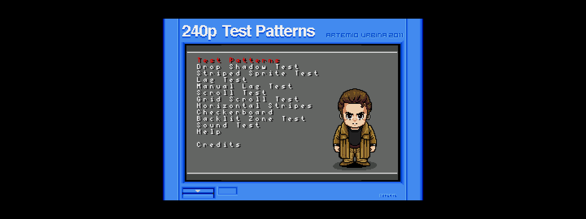

# evo_genesis — Sega Genesis / Mega Drive

A launcher tile that plays your own Sega ROM files on the head unit — Genesis /
Mega Drive, and with the same core Master System and Game Gear — with an Xbox
controller (through [evo_padd](../evo_padd/README.md)), the iDrive knob or a USB
keyboard, sound out of the car's speakers, battery saves, save states and a choice
of how the picture fills the wide panel.



It is two parts: the **Genesis Plus GX** emulator core, and the small libretro
frontend this project shares with the SNES tile ([evo_retro](../evo_retro/README.md)
— picture, sound, input, menus, saves). This folder holds what is specific to the
Genesis: the tile's descriptor and icon, its launch script, and the script that
fetches and builds the core.

No games, no BIOS files and no emulator core are in this repository: ROMs are yours
to supply, and the core is fetched when you build (see [Licences](#licences)).

## Controls

| Xbox pad | Genesis |
|---|---|
| D-pad or left stick | D-pad, with diagonals |
| A / B / X / Y | B / C / A / Y |
| LB / RB | X / Z |
| Menu / View | Start / Mode |
| **Xbox button** | the in-game menu |
| second pad | player 2 |

The in-game menu pauses the game: **Resume**, **Save state**, **Load state** (four
slots per game, left / right or LB / RB to choose), **Settings**, **Reset the
console**, **Change game** (back to the list) and **Quit** (back to the launcher).
In the menu and the ROM list, A chooses and B goes back; LB / RB page through a
long list. The menu and the settings page look the same as on the
[SNES tile](../evo_snes/README.md).

Without a gamepad the basics still work:

| | iDrive | USB keyboard |
|---|---|---|
| D-pad (one direction at a time on the knob) | tilt | arrows |
| B / C / A / Y | press / OPTION / MEDIA / – | Z / X / A / S |
| X / Z | – | Q / W |
| Start / Mode | NAV / TEL | Enter / Tab |
| menu | BACK | Esc |
| move in a list or menu | rotate or tilt | arrows |

MENU on the iDrive controller is left alone, as in the other tiles.

## Settings

**Settings** in the in-game menu; left / right change a value and it applies at
once (the page sits at the left edge so the picture stays in view while you change
its fit).

| Setting | Values (the first is the default) |
|---|---|
| Picture | **Sharp 2x** — whole-number scale, every pixel the same size (640×448) · **Full height** — all 540 rows, square pixels (771 wide) · **TV 4:3** — all 540 rows, 720 wide, the shape of the TV the console was made for · **Wide 16:9** — 960 wide, stretched |
| Sound level | 300 %, in steps from 50 % to 600 % |
| Controller | Auto (what each game was made for) · 3 buttons · 6 buttons |
| Region | Auto · USA · Europe · Japan. Takes effect after **Reset the console** |
| Sprite limit | On (as the console) · Off (no flicker when many sprites share a line) |

They are kept in `/fs/sda1/evo/genesis/settings.txt`, plain `key = value` lines. A
line the menu does not know is handed to the emulator core as one of its own
options and kept when the menu rewrites the file, so any other Genesis Plus GX
option can be set by hand — for example `genesis_plus_gx_audio_filter = low-pass`.
The sound level lives in `/fs/sda1/evo/genesis_gain`, the file the launch script
reads.

## Games and saves

- Put ROM files in **`/fs/sda1/evo/genesis/`** (`.md .smd .gen .bin`, plus
  `.sms .gg .sg` for the 8-bit Sega systems), plain or zipped, one game per `.zip`
  (the first game found in the archive is the one played).
- **Sega CD:** a `.cue` file with its track files beside it, or an `.iso`. It needs
  the console's BIOS, which you supply: `bios_CD_U.bin`, `bios_CD_E.bin` or
  `bios_CD_J.bin` in `/fs/sda1/evo/genesis/system/`. Track files named by a `.cue`
  are left off the list, so a disc shows once. See [Limits](#limits): this path is
  wired up but has not been run with a BIOS.
- Saves live in `/fs/sda1/evo/genesis/saves/`. The cartridge's battery memory is
  `<game>.srm`, written about a second after the game changes it (a car can lose
  power at any moment) and again when you pause or quit. Save states are
  `<game>.st1` … `.st4`.
- Sound level: in Settings. The default is 300 % because the unit attenuates this
  sound source; a soft limiter rounds off the loudest passages instead of clipping
  them.

## Build

```sh
make -C projects/evo_genesis                # -> bin/evo_genesis
python3 projects/evo_genesis/make_icon.py   # genesis.rgba / genesis.png (original controller glyph)
```

The first `make` runs [`core.sh`](core.sh): it fetches Genesis Plus GX at a pinned
commit into `core/` (gitignored) and compiles it with the unit's toolchain into
`build/evo_retro/libretro_genesis.a` (under a minute). After that `make`
rebuilds only the frontend. `./core.sh -f` forces the core to be rebuilt.

`./scripts/deploy.sh evo_genesis` builds, pushes the binary, the launch script and
the icon, and regenerates the launcher manifest from [`app.desc`](app.desc).

## Run

The launcher tile runs [`target/genesis_launch.sh`](target/genesis_launch.sh), which
sets the audio library path and restores the BMW screen if the emulator crashes.
Log: `/dev/shmem/genesis_launch_stdout.log`. By hand,
`./evo_genesis /fs/sda1/evo/genesis/game.md` skips the list. The test switches
(`EVO_RETRO_STATS` and friends) are described in the
[frontend's README](../evo_retro/README.md#run-and-test).

## Limits

- Tested from scripts and screenshots, with measured sound statistics. How it feels
  to play and how it sounds have not yet been judged by a person.
- **Sega CD has not been run.** The list, the hidden track files and the "needs a
  BIOS" message are checked; loading an actual disc needs a BIOS file, which this
  project cannot supply. Known gaps before trying: `.chd` images and compressed
  (MP3 / OGG) audio tracks are not built into the core, and a disc's backup memory
  is written by the core only when the game is left, not a second after it changes.
- Genesis Plus GX will "run" any file, even a two-byte one, as a black screen, so
  the frontend refuses files too small to be a game.
- The limits of the frontend (settings only from the in-game menu, a `.zip` read
  whole into memory) are listed in its [README](../evo_retro/README.md#limits).

## Licences

What is in this folder, and the frontend it builds, is this project's own code (MIT).

**Genesis Plus GX** is not free software in the usual sense: it may be used and
redistributed free of charge but **not commercially**, and modified versions must
come with their source. That is why the core is not in this repository — `core.sh`
fetches it from its upstream repository
([libretro/Genesis-Plus-GX](https://github.com/libretro/Genesis-Plus-GX)) at a
pinned commit — and why a built `evo_genesis` may only be passed on
non-commercially, with that notice and the core's own licence file. The core builds
unmodified (its own switch for strict-alignment CPUs, `-DALIGN_LONG`, is all this
unit needs). Commercial ROMs and BIOS images are never part of this project.
