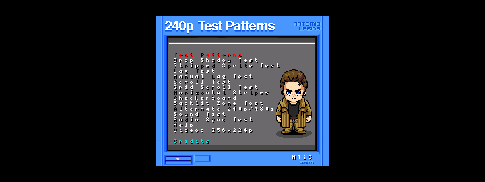
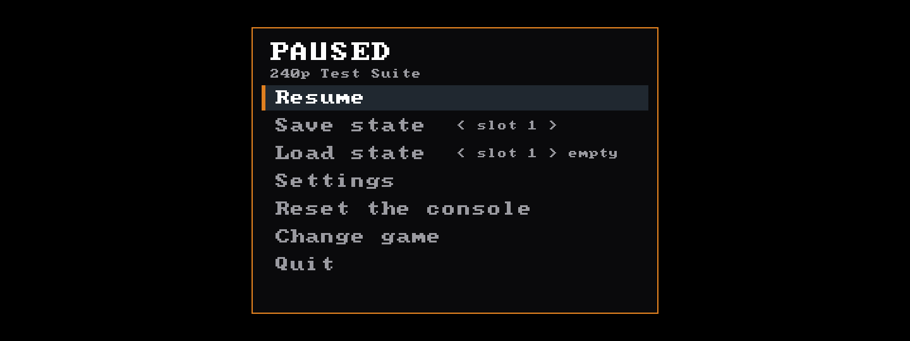
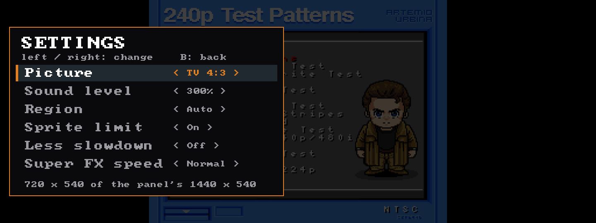

# evo_snes — Super Nintendo

A launcher tile that plays your own SNES ROM files on the head unit, with an Xbox
controller (through [evo_padd](../evo_padd/README.md)), the iDrive knob or a USB
keyboard, sound out of the car's speakers, battery saves, save states and a choice
of how the picture fills the wide panel.



It is two parts: the **Snes9x 2010** emulator core, and the small libretro frontend
this project shares with the Genesis tile ([evo_retro](../evo_retro/README.md) —
picture, sound, input, menus, saves). This folder holds what is specific to the
SNES: the tile's descriptor and icon, its launch script, and the script that
fetches, patches and builds the core.

No games and no emulator core are in this repository: ROMs are yours to supply,
and the core is fetched when you build (see [Licences](#licences)).

## Controls

| Xbox pad | SNES |
|---|---|
| D-pad or left stick | D-pad, with diagonals |
| A / B / X / Y | B / A / Y / X — the same positions as on an SNES pad |
| LB / RB | L / R |
| Menu / View | Start / Select |
| **Xbox button** | the in-game menu |
| second pad | player 2 |

The in-game menu pauses the game: **Resume**, **Save state**, **Load state** (four
slots per game, left / right or LB / RB to choose), **Settings**, **Reset the
console**, **Change game** (back to the list) and **Quit** (back to the launcher).
In the menu and the ROM list, A chooses and B goes back; LB / RB page through a
long list.



Without a gamepad the basics still work:

| | iDrive | USB keyboard |
|---|---|---|
| D-pad (one direction at a time on the knob) | tilt | arrows |
| B / A / Y / X | press / OPTION / MEDIA / – | Z / X / A / S |
| L / R | – | Q / W |
| Start / Select | NAV / TEL | Enter / Tab |
| menu | BACK | Esc |
| move in a list or menu | rotate or tilt | arrows |

MENU on the iDrive controller is left alone, as in the other tiles.

## Settings

**Settings** in the in-game menu; left / right change a value and it applies at
once (the page sits at the left edge so the picture stays in view while you change
its fit).



| Setting | Values (the first is the default) |
|---|---|
| Picture | **Sharp 2x** — whole-number scale, every pixel the same size (512×448) · **Full height** — all 540 rows, square pixels (617 wide) · **TV 4:3** — all 540 rows, 720 wide, the shape of the TV the console was made for · **Wide 16:9** — 960 wide, stretched |
| Sound level | 300 %, in steps from 50 % to 600 % |
| Region | Auto · NTSC 60 Hz · PAL 50 Hz. Takes effect after **Reset the console** |
| Sprite limit | On (as the console) · Off (no flicker when many sprites share a line) |
| Less slowdown | Off · Light · Medium · Most — a faster console processor; can upset some games |
| Super FX speed | Normal · 1.5x · 2x · 4x — for Super FX cartridges |

They are kept in `/fs/sda1/evo/snes/settings.txt`, plain `key = value` lines. A
line the menu does not know is handed to the emulator core as one of its own
options and kept when the menu rewrites the file, so any other Snes9x 2010 option
can be set by hand. The sound level lives in `/fs/sda1/evo/snes_gain`, the file
the launch script reads.

## Games and saves

- Put ROM files in **`/fs/sda1/evo/snes/`** (`.sfc .smc .swc .fig`), plain or
  zipped, one game per `.zip` (the first game found in the archive is the one
  played).
- Saves live in `/fs/sda1/evo/snes/saves/`. The cartridge's battery memory is
  `<game>.srm`, written about a second after the game changes it (a car can lose
  power at any moment) and again when you pause or quit. Save states are
  `<game>.st1` … `.st4`.
- Sound level: in Settings. The default is 300 % because the unit attenuates this
  sound source; a soft limiter rounds off the loudest passages instead of clipping
  them.

## Build

```sh
make -C projects/evo_snes                # -> bin/evo_snes
python3 projects/evo_snes/make_icon.py   # snes.rgba / snes.png (original controller glyph)
```

The first `make` runs [`core.sh`](core.sh): it fetches Snes9x 2010 at a pinned
commit into `core/` (gitignored), applies [`patches/`](patches) and compiles it
with the unit's toolchain into `build/evo_retro/libretro_snes.a` (under a
minute). After that `make` rebuilds only the frontend. `./core.sh -f` forces the
core to be rebuilt.

`./scripts/deploy.sh evo_snes` builds, pushes the binary, the launch script and the
icon, and regenerates the launcher manifest from [`app.desc`](app.desc).

## Run

The launcher tile runs [`target/snes_launch.sh`](target/snes_launch.sh), which sets
the audio library path and restores the BMW screen if the emulator crashes. Log:
`/dev/shmem/snes_launch_stdout.log`. By hand, `./evo_snes /fs/sda1/evo/snes/game.sfc`
skips the list. The test switches (`EVO_RETRO_STATS` and friends) are described in
the [frontend's README](../evo_retro/README.md#run-and-test).

## Limits

- Tested from scripts and screenshots, with measured sound statistics. How it feels
  to play and how it sounds have not yet been judged by a person.
- **Cartridges with extra processors** are unproven with real games. The Super FX's
  arithmetic passes its test ROMs on the unit, but two synthetic Super FX drawing
  demos ran at 70 % speed and drew wrongly, which may be those demos or may be the
  emulation under full load. SA-1 has not been tried. If a game is too slow:
  Settings > Super FX speed, or the lighter Snes9x 2005 core (`./core.sh snes2005`,
  then `make CORE=snes2005`; it links, but has only been run in the benchmark, and
  the Region, Sprite limit, Less slowdown and Super FX settings are Snes9x 2010's).
- Snes9x 2010 rejects a cartridge header that claims less than 128 KB, which some
  homebrew test ROMs do.
- The limits of the frontend (settings only from the in-game menu, a `.zip` read
  whole into memory) are listed in its [README](../evo_retro/README.md#limits).

## Licences

What is in this folder, and the frontend it builds, is this project's own code (MIT).

**Snes9x** is not free software in the usual sense: it may be used and
redistributed free of charge but **not commercially**. That is why the core is not
in this repository — `core.sh` fetches it from its upstream repository
([libretro/snes9x2010](https://github.com/libretro/snes9x2010)) at a pinned commit —
and why a built `evo_snes` may only be passed on non-commercially, with that notice
and Snes9x's own licence file. Commercial ROMs are never part of this project.

The two changes made to the core: its sound code reads 16-bit values at odd
addresses, which this CPU refuses (two macros made byte-wise,
[`patches/snes9x2010-unaligned-apu.patch`](patches/snes9x2010-unaligned-apu.patch)),
and it uses a GCC atomic helper that does not exist for this toolchain
([`patches/sync_shim.c`](patches/sync_shim.c)).
